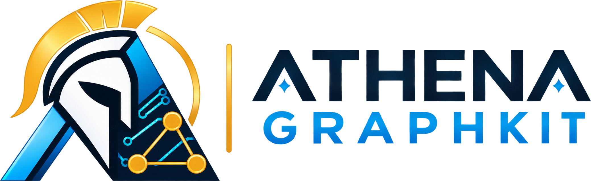
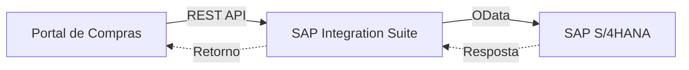
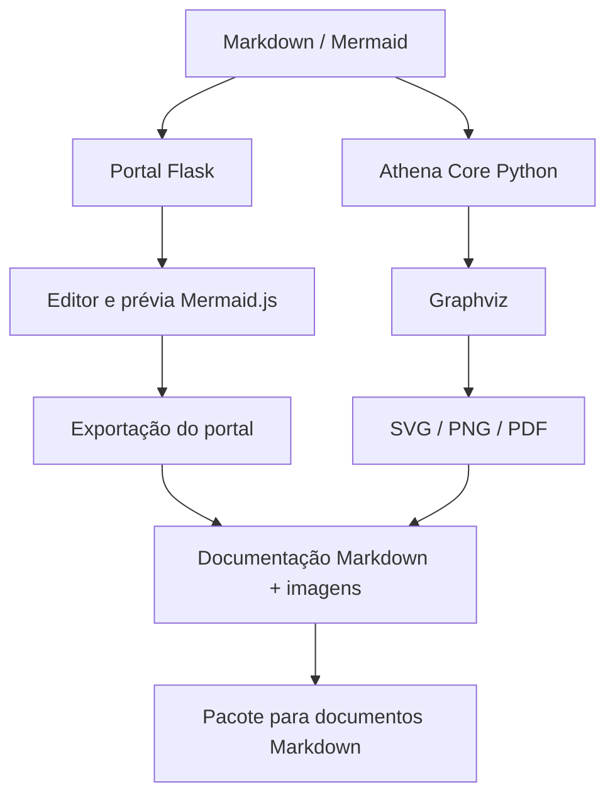

<div align="center">

<picture>
  <source media="(prefers-color-scheme: dark)" srcset="portal/static/branding/athena-logo-dark.png">
  
</picture>

# Athena GraphKit

### Engineering diagrams. Shared understanding.

**Do código à arquitetura visual. Da arquitetura à documentação compartilhada.**

[](#versão-e-status) [](#início-rápido) [](#o-portal) [](#diagramas-e-compatibilidade) [](#como-funciona)

**[Início rápido](#início-rápido) · [Recursos](#por-que-usar) · [Portal](#o-portal) · [Documentação](#documentação-e-documentos-markdown) · [Arquitetura](#estrutura-do-projeto) · [Referências](#referências)**

</div>

---

## Sobre

Diagramas são a linguagem comum entre quem projeta, desenvolve, integra e mantém sistemas. O **Athena GraphKit** transforma definições textuais e modelos visuais em diagramas reutilizáveis, organizados por projeto e prontos para integrar documentação técnica.

O projeto reúne um **portal Flask local**, um **motor Python/Graphviz**, edição de Mermaid, temas visuais e uma área de documentação Markdown. Você pode começar escrevendo código, usar os componentes do editor visual ou combinar as duas abordagens — sem precisar hospedar seus projetos em um serviço externo.

> **Athena** representa estratégia e inteligência aplicada à engenharia. **GraphKit** é o conjunto de ferramentas para construir, comunicar e documentar arquiteturas e fluxos.

## Por que usar

- **🎨 Editor visual e código lado a lado** — construa fluxos com componentes ou escreva Mermaid e confira a prévia.
- **🗂️ Projetos organizados** — mantenha vários diagramas e documentos Markdown no mesmo projeto, salvos localmente.
- **🔗 Conexões expressivas** — direções, rótulos, âncoras e curvas suaves no quadro visual; zoom, multisseleção e desfazer/refazer.
- **🧩 Diferentes famílias de diagramas** — flowchart, sequência, ER, classes, C4 e BPMN simplificado, respeitando o suporte de cada editor.
- **🌗 Identidade visual consistente** — interface Dark por padrão, alternativa Light e temas de diagramas Dark, Corporativo e SAP Fiori.
- **📖 Manuais no próprio portal** — documentação em Markdown acessível pela interface.
- **📦 Exportação para documentação** — gere SVG/PNG conforme o renderizador e prepare pacotes de Markdown e imagens para outros editores de documentação.
- **🔌 Núcleo reutilizável** — execução direta via Python, Skill ChatGPT e servidor MCP local opcional.

---

## Início rápido

### Windows — forma recomendada

Na pasta do projeto, execute no PowerShell:

```powershell
powershell -NoProfile -ExecutionPolicy Bypass -File .\iniciar_portal.ps1
```

O script procura o Python, utiliza/cria o ambiente virtual `venv/`, verifica dependências, inicia o Flask e tenta abrir o Chrome (ou o navegador padrão) em **http://127.0.0.1:5000**.

> A instalação de dependências Python pode exigir acesso à rede ou ao repositório interno da empresa. Não é necessário instalar pacotes globalmente para usar o ambiente virtual.

### Inicialização manual

Requisitos: **Python 3.10+**, [Graphviz](https://graphviz.org/download/) (`dot` no `PATH`) e dependências Python.

```powershell
py -m venv venv
.\venv\Scripts\Activate.ps1
python -m pip install -r requirements.txt
python portal.py
```

Abra **http://127.0.0.1:5000**.

### Execução sem portal

```powershell
python gerador.py --arquivo entradas/integracao_sap.md --tema dark --formato svg
python gerador.py --pasta entradas --tema corporativo --formato png
```

A CLI usa o conversor Python/Graphviz e atende ao subconjunto de **`flowchart`/`graph`** suportado pelo parser. Para sequência, ER, classes e C4, use o editor e a prévia Mermaid no portal.

---

## Um tour pelo Athena

| **Studio — criação** | **Editor — conexões** |
|:--|:--|
| Projetos com múltiplos diagramas; abas de edição visual, Mermaid, prévia e documento Markdown. | Componentes, direção de setas, curvas Bézier, seleção múltipla, zoom e atalhos. |
| **Documentação — publicação** | **Temas — apresentação** |
| Markdown com referências a diagramas, verificação de IDs e pacote de imagens para documentação. | Dark, Corporativo e SAP Fiori para diagramas; Dark/Light para a interface. |

### Exemplo: um fluxo de integração



O mesmo fluxo pode ser descrito em um arquivo `.md` com bloco `mermaid` ou em um arquivo `.mmd`, respeitando o subconjunto suportado pelo mecanismo escolhido.

## O portal

O portal Flask é a interface local de trabalho. Os diagramas podem ser criados e salvos em projetos, editados pelo quadro visual quando o tipo permite, ou mantidos como código Mermaid com prévia. Os manuais ficam disponíveis no próprio aplicativo.

| Área | Para que serve |
|---|---|
| **Projetos** | Criar, abrir, salvar, importar e fazer backup dos trabalhos. |
| **Editor visual** | Organizar nós e conexões dos tipos visualmente suportados. |
| **Código Mermaid** | Escrever e revisar a definição textual do diagrama. |
| **Prévia** | Visualizar o resultado com Mermaid.js. |
| **Documento Markdown** | Produzir a narrativa técnica e referenciar diagramas. |
| **Manuais** | Consultar os guias `.md` da pasta `manuais/`. |

### Aparência e idiomas

| Configuração | Opções | Padrão |
|---|---|---|
| Tema do portal | Dark / Light | **Dark** |
| Idioma da interface | Português / English | **Português** |
| Tema dos diagramas | Dark / Corporativo / SAP Fiori | **Dark** |

As preferências do portal são mantidas no navegador. A tradução ainda é parcial: alguns textos dinâmicos e inspetores permanecem em português.

## Diagramas e compatibilidade

O Athena combina **dois caminhos de renderização**: Mermaid.js na prévia web e o conversor Python/Graphviz na CLI. Eles **não possuem cobertura idêntica**.

| Tipo | Sintaxe Mermaid | Suporte no Studio |
|---|---|---|
| Fluxos | `flowchart` / `graph` | Editor visual e prévia; subconjunto na CLI |
| Sequência | `sequenceDiagram` | Editor especializado e prévia Mermaid |
| Entidade-relacionamento | `erDiagram` | Formulários estruturados e prévia |
| Classes UML | `classDiagram` | Formulários estruturados e prévia |
| Arquitetura C4 | `C4Context`, `C4Container`, `C4Component` | Editor para comandos suportados e prévia |
| BPMN | Modelagem simplificada em `flowchart` | Biblioteca de formas; **não é BPMN 2.0 XML** |

> **Importante:** editar um diagrama no Mermaid não garante que todos os elementos possam ser importados para o quadro visual. O importador rejeita instruções desconhecidas para reduzir o risco de perda de conteúdo.

---

## Documentação e documentos Markdown

O Athena também é um editor de documentação técnica. Na aba **Documento Markdown**, combine texto, títulos e referências aos diagramas do projeto:

```markdown
# Arquitetura de integração

## Fluxo de comunicação

O fluxo abaixo representa a integração entre os componentes.

{{diagram:ID_DO_DIAGRAMA}}
```

**Fluxo de exportação:**

1. Crie e salve os diagramas do projeto.
2. Insira os marcadores `{{diagram:ID}}` no Markdown.
3. Utilize **Validar referências** para localizar IDs ausentes.
4. Escolha **Exportar documentação**.
5. Extraia o pacote com `documento_athena.md`, `imagens/*.png`, `manifest.json` e `README.txt`.
6. Utilize o Markdown e as imagens em qualquer ferramenta de documentação compatível, preservando os caminhos relativos.

O Athena **não gera DOCX diretamente**. O pacote pode ser consumido por conversores de documentos independentes. A exportação depende da disponibilidade do renderizador PNG no ambiente local.

### Cairo portátil no Windows

A exportação PNG do portal utiliza CairoSVG no servidor. O pacote Python `cairosvg` precisa da biblioteca **Cairo nativa**. O projeto procura DLLs locais em `libs/cairo/bin/` e importa CairoSVG somente quando necessário para exportar.

**O código-fonte usa o Cairo instalado ou fornecido localmente. O pacote portátil inclui a biblioteca nativa.** Consulte [`libs/cairo/README.md`](libs/cairo/README.md) para preparar o runtime local. Sem elas, o portal pode iniciar, mas exportações PNG e pacotes com imagens podem falhar. Para diagnosticar um erro HTTP 422, consulte a resposta de `/api/export/png` nas ferramentas de desenvolvedor do navegador.

---

## Como funciona



O **Athena Core** fica separado da interface Flask, permitindo automação por linha de comando e integração opcional com outras ferramentas.

## Estrutura do projeto

```text
athena-graphkit/
├── portal.py                 # Aplicação Flask
├── iniciar_portal.ps1        # Inicialização local no Windows
├── gerador.py                # CLI de geração
├── athena/                   # API Python reutilizável
├── core/                     # Leitor, parser, temas e renderizador
├── portal/                   # Interface e arquivos estáticos
│   └── static/branding/      # Logos, ícones e favicon
├── temas/                    # Paletas Dark, Corporativo e SAP Fiori
├── entradas/                 # Exemplos de Markdown/Mermaid
├── saidas/                   # Diagramas exportados
├── workspace/projects/       # Projetos locais
├── manuais/                  # Guias Markdown consultáveis no portal
├── libs/cairo/               # Local opcional para DLLs Cairo
├── plugin/                   # Skill e metadados ChatGPT
├── mcp_server.py             # Integração MCP opcional
├── tests/ e tests_js/        # Testes automatizados
└── README.md
```

### Skill ChatGPT e MCP

A pasta `plugin/` contém uma Skill para instruir o ChatGPT a usar o motor compatível. O servidor MCP local é **opcional**, utiliza transporte `stdio` e oferece `list_themes`, `render_diagram` e `prepare_documentation`.

```powershell
python -m pip install -r requirements-mcp.txt
python mcp_server.py
```

A instalação da Skill e a conexão MCP exigem um ambiente compatível. Não há endpoint remoto publicado nem integração automática entre plugins.

---

## Manuais e referências

Abra **Manuais** no cabeçalho do portal ou consulte diretamente os arquivos da pasta [`manuais/`](manuais/):

| Manual | Conteúdo |
|---|---|
| [`01_inicio.md`](manuais/01_inicio.md) | Instalação, execução e configuração |
| [`02_diagramas.md`](manuais/02_diagramas.md) | Tipos e sintaxe Mermaid |
| [`03_exportacao_documentos.md`](manuais/03_exportacao_documentos.md) | Preparação de documentos corporativos |
| [`04_bpmn.md`](manuais/04_bpmn.md) | Elementos e limites da modelagem BPMN |
| [`05_atalhos.md`](manuais/05_atalhos.md) | Atalhos e edição visual |
| [`06_documentos_e_c4.md`](manuais/06_documentos_e_c4.md) | Documentos e arquitetura C4 |
| [`07_mcp_e_backup.md`](manuais/07_mcp_e_backup.md) | MCP e portabilidade |
| [`08_idiomas_e_temas.md`](manuais/08_idiomas_e_temas.md) | i18n e personalização |

**Documentação oficial:** [Markdown Guide](https://www.markdownguide.org/) · [Mermaid](https://mermaid.js.org/) · [Mermaid Live](https://mermaid.live/) · [Graphviz DOT](https://graphviz.org/doc/info/lang.html) · [Graphviz Attributes](https://graphviz.org/doc/info/attrs.html) · [Python Graphviz](https://graphviz.readthedocs.io/) · [Flask](https://flask.palletsprojects.com/) · [BPMN 2.0](https://www.omg.org/spec/BPMN/2.0.2/)

## Testes e diagnóstico

```powershell
python -m unittest discover -s tests -v
node --test tests_js/*.mjs
python -m compileall -q .
```

Esses testes não substituem a validação no navegador, especialmente para **PNG**, **pacotes de documentação**, **diagramas de sequência complexos** e **importação de projetos**.

Se a interface parecer desatualizada, recarregue com `Ctrl+Shift+R`. Se o portal importar pacotes de uma versão anterior, confirme que o PowerShell está utilizando o `venv` desta pasta.

## Versão e status

**Versão de lançamento: `1.4.2`** — consolidação da linha de desenvolvimento anterior. Veja [`RELEASE_NOTES_1.4.2.md`](RELEASE_NOTES_1.4.2.md) para o histórico do lançamento.

O projeto está em fase de **lançamento e testes locais**. Pontos conhecidos: cobertura Mermaid desigual entre portal e CLI; BPMN simplificado; tradução parcial; e integração MCP/ChatGPT dependente de configuração e validação no ambiente de destino.

## Contribuindo

Encontrou um problema, quer sugerir um novo componente ou melhorar a documentação? Ao reportar um erro, inclua a versão, o tipo de diagrama, o código Mermaid mínimo para reproduzi-lo e a mensagem exibida no navegador ou terminal.

Não há necessidade de alterar os projetos existentes para colaborar com o código: preserve `workspace/projects/` antes de testar versões novas.

## Autoria

<div align="center">

**Christopher N. S. M. Mauricio**

*Athena GraphKit — Engineering diagrams. Shared understanding.*

</div>

---


## Pacote portátil Windows e Linux

Extraia a release correspondente à sua plataforma em uma pasta gravável e
abra `iniciar_portatil.bat` no Windows x64 ou execute
`./iniciar_portatil.sh` no Linux x64. Abra
[http://127.0.0.1:5000](http://127.0.0.1:5000) quando o servidor iniciar.

O pacote inclui Python, Flask, Mermaid, Graphviz (`dot`) e Cairo. A primeira
execução ajusta os caminhos do runtime para a pasta de extração. Para mudar a
instalação de lugar, extraia novamente o pacote e copie `workspace/projects/`.
O pacote Linux requer um sistema x64 compatível com a glibc do build.
Windows ARM64, Linux ARM64 e Linux musl exigem builds próprios.

Passe `--check` para verificar Mermaid, Graphviz, Cairo e o ZIP de
documentação. Use `--cli` para geração em lote pela configuração local
`config.json` ou `--mcp` para iniciar o servidor MCP.

O workflow **Pacotes portáteis** prepara e testa os arquivos por plataforma.
O manifesto e as licenças do runtime acompanham a distribuição.

## Modo hospedado e colaboração

Consulte o [deploy no PythonAnywhere](deploy/README.md) para configurar WSGI,
atualização a cada dez minutos e logs. O [modelo de acesso](deploy/ACCESS.md)
explica autenticação, organizações, grupos, permissões e como reaproveitar
o módulo `athena_access` em outro aplicativo Flask.
