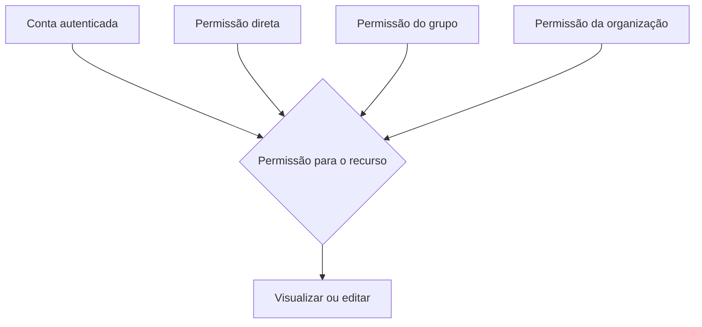

# Contas e compartilhamento

A conta pertence a zero ou mais organizações. Cada grupo pertence a uma
organização. O operador inclui a conta na organização antes de incluí-la em
um grupo. A remoção da organização remove a associação aos grupos dela.



| Concessão | O que inclui |
|---|---|
| Visualizar projeto | Abrir e exportar o projeto, a documentação e os diagramas do projeto. |
| Editar projeto | Visualizar e salvar os dados e diagramas do projeto. |
| Visualizar diagrama | Abrir a prévia e o código da peça compartilhada. |
| Editar diagrama | Visualizar e salvar o título e o código da peça compartilhada. |
| Proprietário | Editar, excluir e conceder ou revogar acessos ao projeto e seus diagramas. |

O servidor aplica a maior permissão efetiva recebida de forma direta, por
grupo ou por organização. O acesso ao projeto se estende aos seus diagramas.
O acesso isolado a um diagrama fica restrito à página desse diagrama.
Ao salvar, a revisão precisa coincidir com a que estava aberta.
Uma aba desatualizada recebe HTTP 409.

Use **Compartilhamento** no Studio para encontrar diagramas recebidos.
Em um projeto próprio, use **Permissões** para compartilhar com uma conta
por e-mail ou com grupo/organização por identificador. Use **Remover** para
revogar a concessão. A pessoa pode continuar tendo acesso por outro vínculo.

## Gestão de contas e grupos

No diretório `current`, com o ambiente do [deploy](README.md) configurado:

```bash
./.venv/bin/python -m flask --app portal access user pessoa@exemplo.com
./.venv/bin/python -m flask --app portal access organization empresa "Empresa"
./.venv/bin/python -m flask --app portal access group engenharia "Engenharia" empresa
./.venv/bin/python -m flask --app portal access member organization empresa pessoa@exemplo.com
./.venv/bin/python -m flask --app portal access member group engenharia pessoa@exemplo.com
./.venv/bin/python -m flask --app portal access import-project pessoa@exemplo.com /caminho/projeto.json
```

Use `access member ... --remove` para remover uma participação.
Use `access disable pessoa@exemplo.com` para desativar uma conta ou
`--enable` para reativá-la. Na tela de login, **Criar conta** permite preencher e-mail, senha e
confirmação e entrar no Studio na hora. O cadastro padrão funciona sem SMTP.
Novas contas começam sem vínculos com organizações, grupos ou projetos de
terceiros. Para receber compartilhamentos diretos pelo endereço, a conta
precisa ter o e-mail confirmado. Depois de conferir o endereço, o operador
pode executar `./.venv/bin/python -m flask --app portal access verify-email pessoa@exemplo.com`.

Com SMTP configurado, `"ATHENA_VERIFY_REGISTRATION_BY_EMAIL": true`
exige confirmação por link para novos cadastros. O link de cadastro e o de
recuperação expiram em 30 minutos e funcionam uma vez. A troca de senha
encerra as sessões anteriores. Use `"ATHENA_ALLOW_REGISTRATION": false`
para restringir o cadastro ao operador.

## Reuso em outro app Flask

Copie o pacote `athena_access/`, preservando seus templates e arquivos
estáticos. Inicialize `AccessStore(caminho_sqlite)` e
`Accounts(app, store, enviar_recuperacao, public_endpoints={...})`.
Passe `send_registration(email, caminho)` para habilitar o cadastro por e-mail ou `on_site_registration=True` para cadastro direto. Defina `app.secret_key`, `SESSION_COOKIE_SECURE=True` para HTTPS e, se
necessário, `ACCOUNT_BRAND` e `ACCOUNT_HOME`. Injete
`enviar_recuperacao(email, caminho)` ou use `smtp_delivery`.
A função recebe um caminho relativo. Combine com uma origem HTTPS configurada.

Consulte `g.identity` nas rotas e use `AccessStore.level(db, uid, scope,
resource)` para resolver concessões. A aplicação integradora é responsável
pelo cadastro, pela propriedade dos recursos e pela associação entre os
recursos. `studio.py` e `admin.py` exemplificam essa integração no Athena.
