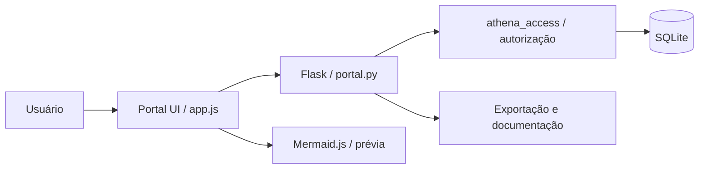
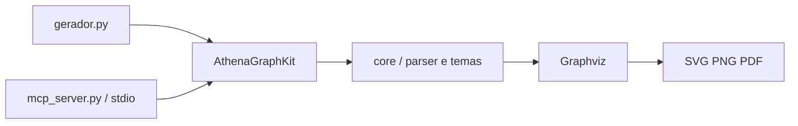
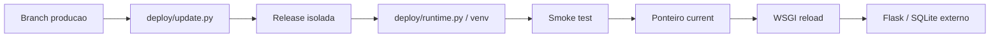

# Referência técnica do Athena GraphKit Studio

Esta referência descreve o Athena GraphKit Studio 1.4.4.
Para operação, consulte o [deploy no PythonAnywhere](../deploy/README.md)
e o [modelo de acesso](../deploy/ACCESS.md).

## Execução e armazenamento

| Entrada | Configuração | Persistência |
| --- | --- | --- |
| `python portal.py` | Flask em `127.0.0.1`, autenticação habilitada, porta padrão 5000 (`ATHENA_PORT`) | SQLite em `workspace/local/athena.sqlite3` |
| `deploy/wsgi.py` | WSGI com `athena-deploy/app.json`, cookies seguros e host confiável quando configurado | SQLite no caminho absoluto de `ATHENA_DATABASE`, fora da pasta de release |
| `python gerador.py --help` | CLI do núcleo de geração | Arquivos de entrada e saída da CLI |

O Studio usa `portal.py` para as rotas, `portal/static/app.js` para o
editor e `athena_access/` para sessões, permissões e armazenamento de
projetos. Projetos legados em JSON podem ser migrados com **Importar projeto**.
As instalações local e hospedada têm contas e bases independentes.

## Layout, grade e salvamento

Cada item em `project.diagrams` guarda o layout do canvas em
`nodes[].x` e `nodes[].y`. O campo opcional `showGrid` é um booleano
por diagrama. Quando ausente em um projeto anterior, a grade aparece.
O controle **Grade** está disponível no Construtor visual para quem pode
editar o projeto.

Arrastar um elemento ou alternar a grade altera o estado no navegador.
**Salvar projeto** envia o documento inteiro ao servidor. Os parâmetros
`projeto` e `diagrama` na URL indicam o que reabrir ao recarregar.
O servidor verifica o acesso normalmente, inclusive ao abrir um link direto.
Um diagrama ausente faz o editor abrir o primeiro disponível no projeto.

| Operação | Contrato com autenticação |
| --- | --- |
| `GET /api/projects/<pid>` | Retorna o projeto e `_access.level` / `_access.revision`. |
| `PUT /api/projects/<pid>` | Salva o projeto JSON com o mesmo `id`, a revisão recebida na leitura e o cabeçalho `X-CSRF-Token` da sessão. Responde com `saved` e a nova `revision`. |

A revisão é um inteiro incrementado no SQLite após cada alteração.
Uma revisão divergente retorna HTTP 409. Recarregue os dados atuais e reconcilie
as alterações antes de repetir o salvamento. O editor atualiza a revisão após
salvar e conserva alterações feitas enquanto a requisição estava em andamento.

## Manuais no portal

O Studio lê arquivos UTF-8 de `manuais/*.md`. Use um nome de arquivo
com prefixo numérico para definir a ordem e um título H1 na primeira linha
para o menu. O FAQ está em `manuais/09_faq.md`.

| Operação | Resposta |
| --- | --- |
| `GET /api/manuals` | Objeto `manuals` com os pares `id` e `title`. O ID vem do nome do arquivo, sem a extensão. |
| `GET /api/manuals/<id>` | Objeto com `id`, Markdown original em `markdown` e HTML renderizado em `html`. Um manual inexistente retorna HTTP 404. |

O Flask renderiza os manuais com `markdown-it-py`, no modo CommonMark
com tabelas habilitadas e interpretação de HTML bruto desabilitada.
Blocos cercados de Mermaid são apresentados como exemplos de código.
A aba **Documento Markdown** do projeto tem sua própria prévia
e substitui referências de diagrama no fluxo de exportação.

## Validação local

Com o ambiente virtual ativo na raiz do repositório:

```bash
python -m pip install -r requirements.txt
python -m unittest discover -s tests
node --test tests_js/*.test.mjs
python portal.py
```

No navegador, mova um nó no segundo diagrama, alterne **Grade**, salve
e recarregue. Confira a seleção e o layout. Em **Manuais**, abra
**Integração MCP e backups** e **Perguntas frequentes (FAQ)** para
conferir a formatação de código e a tabela de permissões.


## Mapa de diretórios e responsabilidades

| Local | Responsabilidade | Interfaces/observações |
| --- | --- | --- |
| `athena/` | Fachada Python (`engine.py`) de geração de artefatos | Consumida por CLI e MCP |
| `core/` | Leitura de arquivos, parser do subconjunto Mermaid, renderizador Graphviz e temas | `leitor.py`, `parser.py`, `renderizador.py`, `temas.py` |
| `portal.py` | Inicialização Flask e rotas do Studio | Reúne APIs e integra componentes de acesso |
| `portal/templates/` | Templates HTML do portal | Apresentação do Studio |
| `portal/static/` | Scripts, estilos e recursos de interface | `app.js`, editor e prévia Mermaid.js |
| `portal/branding-source/` | Fontes de identidade visual | Não confundir com lógica de aplicação |
| `athena_access/` | Sessões, identidade, controle de acesso, dados e integrações do Studio | `accounts.py`, `store.py`, `studio.py`, `admin.py`, `delivery.py`, templates e estáticos |
| `temas/` | Definições JSON de temas de diagramas | Dark, corporativo e SAP Fiori |
| `entradas/` | Exemplos de Mermaid/Markdown | Referência e teste manual |
| `manuais/` | Instruções ao usuário renderizadas no portal | Markdown numerado, API `/api/manuals` |
| `docs/` | Arquitetura, operação de referência e notas de versão | `TECHNICAL.md`, `KNOWLEDGE_SKILLS.md`, `releases/` |
| `deploy/` | Execução hospedada e atualização PythonAnywhere | WSGI, releases, venv, configuração, segurança e permissões |
| `packaging/` | Construção e verificação de distribuição portátil | Arquivamento, runtime, launcher e verificações |
| `plugin/` | Metadados, Skills, scripts e referências para agentes | Plugin distribuível; instalação depende do cliente |
| `tests/` | Testes automatizados Python | Engine, portal, MCP, hospedagem e Cairo |
| `tests_js/` | Testes automatizados JavaScript | Modelo, C4, i18n, estruturados e upgrades |
| `workspace/` | Dados locais e arquivos de projetos legados | Não versionar nem editar dados reais sem backup/autorização |
| `.github/` | Automação e fluxos do GitHub | CI e builds quando configurados |
| `.vscode/` | Configuração do ambiente de desenvolvimento | Execução/depuração local |
| `libs/cairo/` | Instruções ou bibliotecas nativas opcionais Cairo | Necessárias para certos fluxos de PNG |
| `AGENTS.md` | Regras de governança para agentes | Exige aprovação arquitetural antes de alterações |

## Fluxos entre componentes

### Criação e edição no Studio



A edição visual mantém posições em `project.diagrams[].nodes`. O salvamento exige autenticação, CSRF e revisão esperada. Conflitos retornam HTTP 409 para reconciliação. A API deve autorizar acessos independentemente do que a UI mostre.

### Linha de comando e MCP



O `mcp_server.py` registra `list_themes`, `render_diagram` e `prepare_documentation`. O servidor usa `stdio` e não expõe um endpoint HTTP por padrão. Diagramas de sequência, classes, ER e C4 podem ser renderizados no portal com Mermaid.js, mas não devem ser anunciados como compatíveis com o parser Graphviz/MCP.

### Publicação hospedada



O banco e `app.json` ficam fora das pastas de release. Em falha de preparação, a versão ativa deve ser preservada. A limpeza de `releases/` e `venvs/` exige identificar a release ativa, conservar rollback e obter aprovação.

## Organização e atualização do conhecimento para IA

As quatro Skills são declaradas por `plugin/plugin.json`. O mapa detalhado de especializações está em [KNOWLEDGE_SKILLS.md](KNOWLEDGE_SKILLS.md). `AGENTS.md` exige que qualquer agente **apresente decisões propostas e pergunte se o arquiteto concorda antes de modificar arquivos**; autorizações devem ser específicas ao escopo. Modificações funcionais exigem revisão de código, testes, documentação e referências das Skills, sem duplicar os manuais do usuário.

## Matriz de validação por alteração

| Alteração | Validar |
| --- | --- |
| Core/CLI | Testes do engine, entradas Mermaid, arquivos exportados e temas |
| Portal/modelo JS | Testes JS, navegação, salvar/recarregar e tratamento de HTTP 409 |
| Contas/compartilhamento | Autenticação, CSRF, autorização servidor, revisões e isolamento |
| Exportação | SVG/PNG, Cairo e pacote Markdown com referências |
| MCP | Imports do SDK instalado, descoberta e chamadas das três ferramentas |
| Deploy | Smoke test, logs, healthz, release ativa e rollback |
| Skills/documentação | Manifests, frontmatter, referências, caminhos e instruções de aprovação |

Não confundir documentação de comportamento com comprovação de testes executados. Os testes devem ser executados no ambiente apropriado antes de incorporar mudanças de produção.
