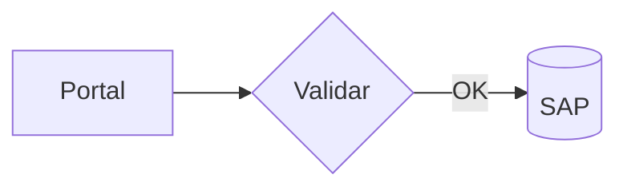
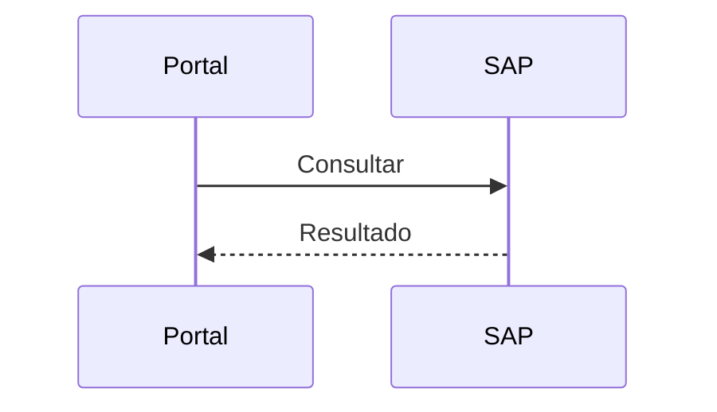

# Diagramas e Mermaid

## Tipos

- Flowchart: fluxos de processos e decisões.
- SequenceDiagram: participantes e mensagens ao longo do tempo.
- DER/MER: entidades e relacionamentos.
- ClassDiagram: classes, métodos e herança.
- C4Context: arquitetura de sistemas (Mermaid experimental).
- BPMN simplificado: símbolos e fluxos visuais, não exportação BPMN XML.

## Exemplo de fluxo

## Exemplo de sequência

## Referências

- [Mermaid](https://mermaid.js.org/intro/)
- [Flowchart](https://mermaid.js.org/syntax/flowchart.html)
- [Sequence](https://mermaid.js.org/syntax/sequenceDiagram.html)
- [ER](https://mermaid.js.org/syntax/entityRelationshipDiagram.html)
- [Class](https://mermaid.js.org/syntax/classDiagram.html)
- [C4](https://mermaid.js.org/syntax/c4.html)
